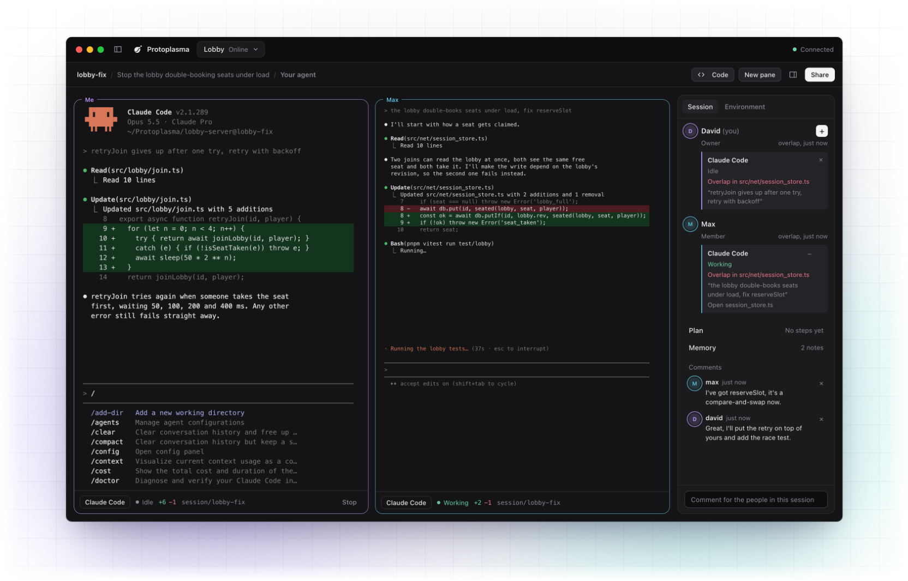
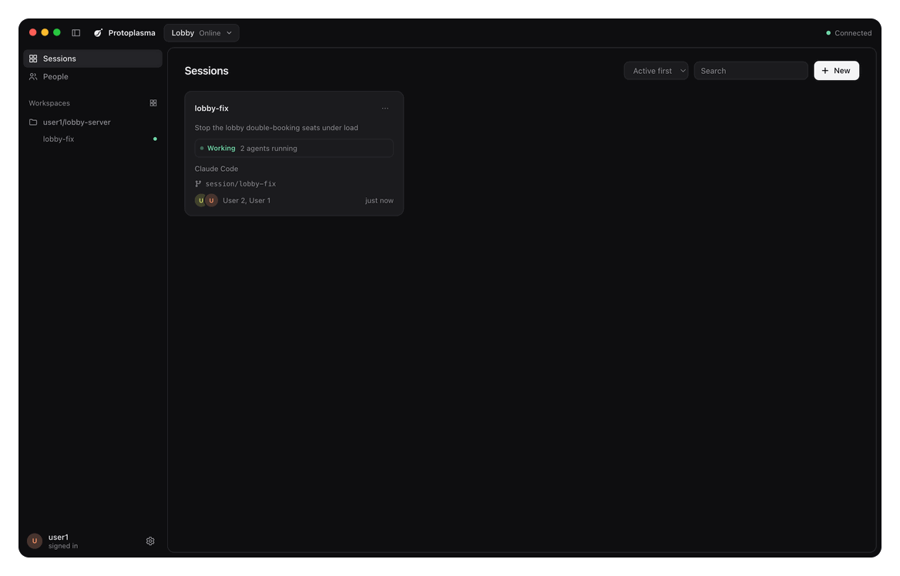
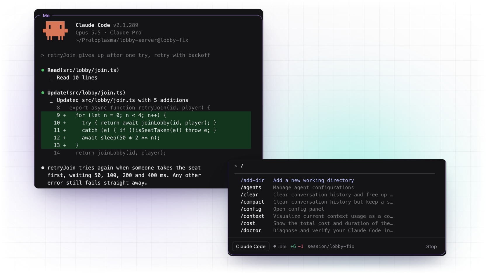
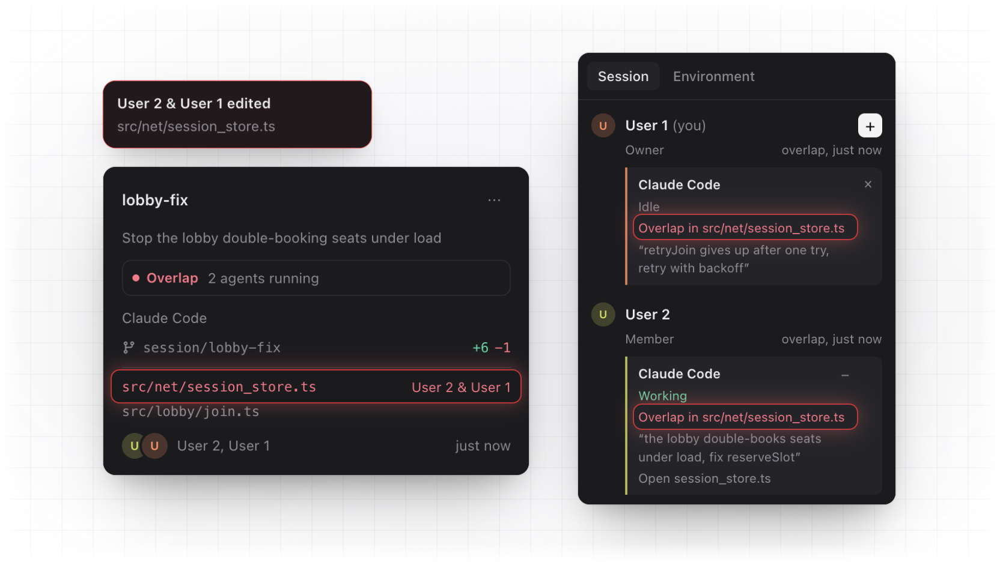
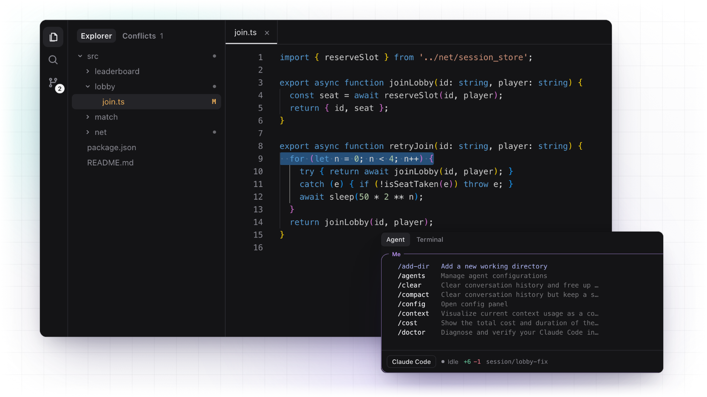
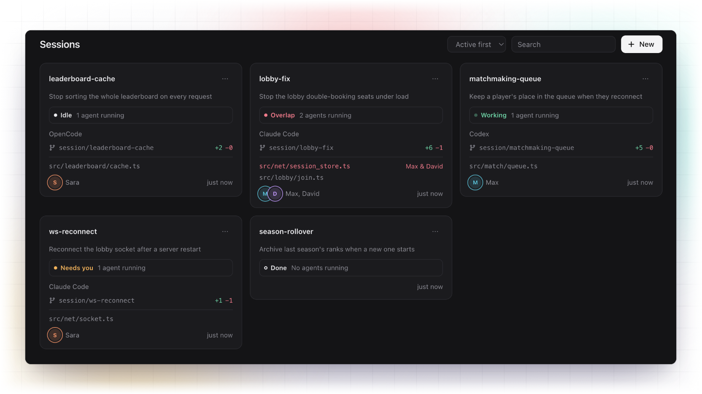
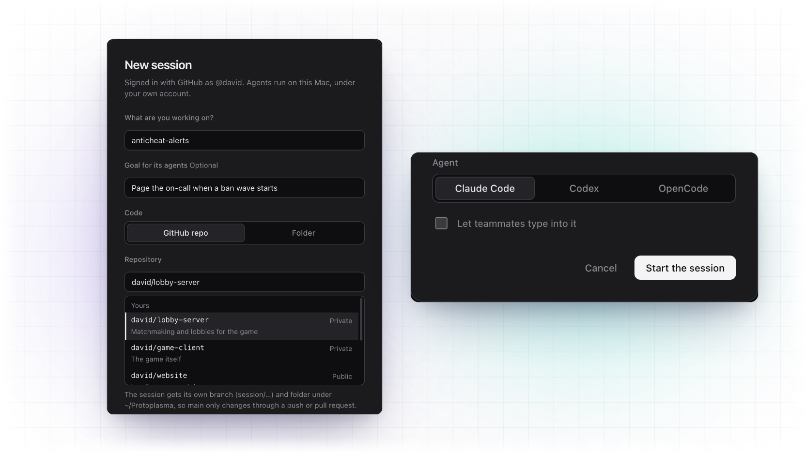
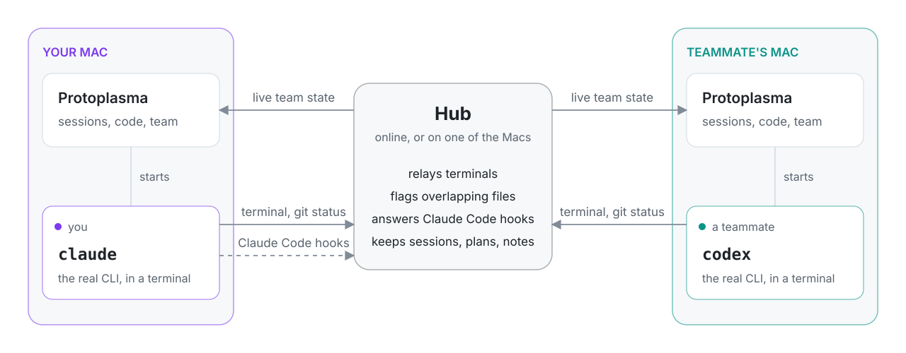

<p align="center">
  
</p>

<h1 align="center">Protoplasma</h1>

<p align="center">
  <b>Multiplayer AI coding on your Mac.</b><br>
  Run the real Claude Code, Codex or OpenCode, every slash command included,<br>
  and see your team's agents right beside yours.
</p>

<p align="center">
  <a href="https://github.com/dw8-ro/protoplasma-ide/releases/latest"></a>
  <a href="https://github.com/dw8-ro/protoplasma-ide/actions/workflows/ci.yml"></a>
  
  
</p>

<p align="center">
  <a href="#install">Install</a> ·
  <a href="#how-you-use-it">How you use it</a> ·
  <a href="#what-it-does">What it does</a> ·
  <a href="#how-it-works">How it works</a> ·
  <a href="#working-on-the-same-code">Working on the same code</a> ·
  <a href="#security-and-privacy">Security and privacy</a>
</p>

<p align="center">
<picture>
  <source media="(prefers-color-scheme: dark)" srcset="docs/readme/hero-dark.png">
  
</picture>
</p>

## Why

Shared spaces for coding agents, like [Amoeba](https://useamoeba.com), drive the agents headlessly, so the CLI you know (its `/goal`, `/compact`, custom commands and skills) isn't there. Protoplasma runs the real interactive CLI in a real terminal and puts the team layer around it: who is working on what, which files are about to collide, and what each agent was last asked. It's laid out the way Amoeba is, so anyone coming from it already knows where things are.

## Install

You'll need a Mac with Apple silicon and at least one of [Claude Code](https://code.claude.com), [Codex](https://github.com/openai/codex) or [OpenCode](https://opencode.ai). Then, in Terminal:

```bash
curl -fsSL https://raw.githubusercontent.com/dw8-ro/protoplasma-ide/main/install.sh | sh
```

That installs the latest release into Applications and opens it, with no "can't be verified" warning (files fetched from Terminal aren't quarantined). You can also download the zip from [Releases](https://github.com/dw8-ro/protoplasma-ide/releases); the first time you open it, macOS asks you to allow it under System Settings → Privacy & Security → Open Anyway.

The [GitHub CLI](https://cli.github.com) (`brew install gh`, then `gh auth login`) powers the repo list, cloning, pull requests and issues. The app runs without it, and on first run it checks for it and for your agents and tells you what's missing.

**Updates install themselves.** The app checks GitHub every few hours and shows a bar when a new version is out. Click **Update now** and it relaunches on the new version. Releases are signed with the project's own certificate (no Apple account involved), so macOS knows each version is the same app and your Keychain and privacy permissions carry over.

## How you use it

1. **Sign in with GitHub** and create a team. Invite people by their GitHub username.
2. **Start a session** with **New** (⌘N). Say what you're working on, pick one of your GitHub repos (or a folder on your Mac) and an agent: Claude Code, Codex or OpenCode. Protoplasma clones the repo, gives the session its own branch and folder, and opens your agent.
3. **Talk to your agent.** It's the real CLI in a terminal, so you type to it exactly as you would in Terminal, slash commands included.
4. **Open the code.** Click **Code**, or any file the session has changed, or press ⌘P. The repo opens in an editor with its files, search and source control, and your agent moves to a panel underneath. As the agent edits a file you have open, you see the change straight away. A **Terminal** tab beside the agent gives you a plain shell in the same folder, and **Conflicts** lists files you and a teammate are both changing, with a side-by-side compare.
5. **Work alongside your team.** Everyone's agents in the session are listed on the right with what they were last asked. Open any of them full size or beside yours, or a teammate's version of a file their agent is changing (if they share files). Plan the work as steps, comment on lines of code (⇧⌘M), and keep notes the agents read. **New pane** puts several sessions side by side.
6. **Ship it.** Write a message under source control and **Commit & Push**, then open a pull request.

<p align="center">
<picture>
  <source media="(prefers-color-scheme: dark)" srcset="docs/readme/demo-dark.gif">
  
</picture>
</p>

<details>
<summary>Keyboard shortcuts</summary>

| Keys | Does |
| --- | --- |
| ⌘N | New session |
| ⇧⌘L | Add an agent to this session |
| ⌘K | Go to a session, page or action |
| ⌘P | Go to a file |
| ⇧⌘E | Show or hide the code |
| ⌘S | Save the open file |
| ⇧⌘M | Comment on the selected lines |
| ⌘J | Hide the panel (under the code, or beside the agents) |
| ⌘B | Hide the sidebar |
| ⌘I | Invite someone to the team |
| ⇧⌘T | Switch team |
| ⌘, | Settings |
</details>

## What it does

### The real agent, not a wrapper

Each agent is the actual `claude`, `codex` or `opencode` process on your Mac, under your own account, in a real terminal. Your settings, permission modes, slash commands, custom commands and skills all work, because you type straight into the CLI. Protoplasma only adds hooks to Claude Code, merged with your own settings, that give it the team's context and ask you before a conflicting edit or a risky push.

<picture>
  <source media="(prefers-color-scheme: dark)" srcset="docs/readme/agents-dark.png">
  
</picture>

### Collisions caught early

While an agent runs, its checkout reports the files changed compared with main, committed or not, whoever or whatever changed them. A file changed in two places is flagged for everyone before it turns into a merge conflict: in the sidebar, on the session's card and beside each agent. Claude Code asks you before it edits a file that another running agent on the same repo has changed, a teammate's or one of yours in another session.

<picture>
  <source media="(prefers-color-scheme: dark)" srcset="docs/readme/overlap-dark.png">
  
</picture>

### The code beside it

An editor built on Monaco (the editor inside VS Code), with an Explorer that marks what changed since the last commit and which files teammates' agents are changing. Your agent moves to a panel underneath, with the session's people and agents beside it, and you see its edits to the file you have open as it makes them.

<picture>
  <source media="(prefers-color-scheme: dark)" srcset="docs/readme/code-dark.png">
  
</picture>

### Sessions for every piece of work

Each session keeps its goal, branch, plan and comments, and stays on the board after its agents stop, with **Resume** to pick the conversation back up and the last screen of recently stopped agents one click away. Its status says at a glance which agents are working, which need you, and where work overlaps. Only Claude Code says when it's waiting for your approval; a Codex or OpenCode agent waiting on one shows as Idle, so check its terminal.

A plan is a list of steps with owners that anyone ticks off. Notes go with a repo or with one file in it, so every session on that repo shares them. Claude gets the plan and the repo's notes with every prompt, and a file's notes just before it reads or edits it.

<picture>
  <source media="(prefers-color-scheme: dark)" srcset="docs/readme/sessions-dark.png">
  
</picture>

### Start from any repo, with any agent

Pick one of your GitHub repos or a folder on your Mac, and the agent to run. A session started from a repo gets its own branch and folder, so `main` only changes through a push or a pull request.

<picture>
  <source media="(prefers-color-scheme: dark)" srcset="docs/readme/start-dark.png">
  
</picture>

## How it works

<picture>
  <source media="(prefers-color-scheme: dark)" srcset="docs/readme/how-it-works-dark.svg">
  
</picture>

- **Lanes** (`src/lane.js`) run an agent in a pseudo-terminal and stream it to the hub, with its branch, what it has changed compared with main, and its status. Claude Code also gets per-run [HTTP hooks](https://code.claude.com/docs/en/hooks) through `--settings`; Codex and OpenCode report working or idle from their terminal activity.
- **The hub** (`src/hub.js`) relays terminals, tracks who changed what, keeps sessions, notes and comments, and answers Claude's hooks with the session's goal, the team's notes and an `ask` before a conflicting edit or a risky push. It never runs agents, and what it keeps or passes along is listed under [Security and privacy](#security-and-privacy). It runs online, or inside the app on one of the team's Macs.
- **The app** (`app/`) is Electron. The renderer has no Node access. The main process launches the agent CLIs (in a clean login-shell environment) and a shell for the Terminal tab, and the code view can only read and write inside a session's own folder.

## Working on the same code

1. **A branch per session.** A session started from a GitHub repo gets its own git worktree on `session/<name>`, branched from the latest default branch, or continuing a teammate's pushed branch. It has no upstream, so a bare `git push` can't land on `main`. Names that differ only in case or punctuation are the same session.
2. **Overlap warnings**, described under [Collisions caught early](#collisions-caught-early).
3. **Push guard.** When the team has other people, Claude Code asks you before pushing to `main`, `master` or the repo's default branch, force-pushing, or deleting a branch on the remote. Codex and OpenCode can't be asked, so in repos the app cloned a `pre-push` hook stops those pushes instead. It's a safeguard against mistakes, not a lock: `git push --no-verify` skips the hook. If your team needs a guarantee, protect `main` on GitHub too, for teammates whose agents push with their own accounts. People pushing from their own terminal aren't affected.
4. **Behind notice.** Each lane fetches about once a minute. A branch missing commits from main (or from its own pushed copy) shows `↓3`, and Claude is told to pull before changing more.
5. **Shared session branches.** Everyone in a session works on `session/<name>`, each in their own checkout. **Commit & Push** puts your commit on top of whatever a teammate pushed first. If you both changed the same lines, it stops and offers **Pull**: their work comes in, the files you both changed are marked C, and once you've fixed them in the editor, **Commit & Push** finishes the merge.

Work then reaches `main` the usual way, through a pull request. These layers make collisions visible early; they don't replace review.

## Security and privacy

- Sign-in asks for read-only access to your public GitHub profile, and nothing else. Repo access stays with the GitHub CLI on your Mac.
- The hub keeps team names, members, notes, and sessions with their goals, repos, who started them, plans and comments (a comment on lines of code keeps the text of those lines). While an agent runs, its terminal output, Claude Code's hook events (which include what a tool is about to change), its latest prompt, its branch, the names of the files its checkout changed and its folder's path pass through the hub. Up to 512 KB of each agent's output is held in memory, along with the last screen of the 20 most recently stopped agents per team; none of it is written to disk.
- Your GitHub sign-in goes only to GitHub, the online hub and the hub on your own Mac. A team hosted on a teammate's Mac is reached over an encrypted connection, pinned to that Mac's certificate, and signed in to with a pass from the online hub that works only on that Mac's hub and expires within 12 hours. The online hub only issues passes for a Mac whose owner registered it, so something on the network pretending to be a teammate's Mac gets nothing it can use. Looking for such teams is off until you turn it on in Your teams, and a team on your Mac can't be reached from the network at all until you invite someone to it.
- The code view reads and writes files on your Mac only, and the hub never stores your code. In the Explorer teammates see which files changed; what your agent prints in its terminal is visible to the whole team. With **Share the files your agents change** on (Settings → Agents, off by default), a teammate can also open those files, read-only; each one passes through the hub on the way and isn't kept.
- Teams are invite-only, and removing someone disconnects them at once. People are recognised by their GitHub account's id, so renaming your account keeps your place, and whoever later takes your old username doesn't get it.
- Letting teammates type into your agent lets them run commands on your Mac, so it's off unless you turn it on, and your agent shows who last typed into it.
- Signing in to a teammate's Mac goes through the online hub, so it needs that hub reachable. Everything else about the team (terminals, typing, files) goes between the two Macs directly.

## Development

```bash
git clone https://github.com/dw8-ro/protoplasma-ide.git
cd protoplasma-ide
npm install
npm start
```

`npm run dist` builds the app into `dist.noindex/Protoplasma-darwin-arm64/`, and `npm run release` publishes a new version: it bumps the version and pushes a tag, and GitHub Actions builds the app and attaches it to a release that everyone's copy picks up.

```bash
npm test            # hub, lane, worktree, code view and update tests (node:test)
npm run e2e         # drives the real app through every main flow, the code view included
npm run screenshot  # regenerates the screenshots in docs/
npm run readme-art  # builds the README images in docs/readme/ from them
npm run demo        # records docs/demo.gif and the README's framed copies
npm run playground  # two copies of the app on one local hub and repo, each with a control API
npm run icon        # renders the app icon from app/icon.svg
```

In the playground, create a team in David's copy and invite `max`. The control API wants the token the playground prints, in an `x-play-token` header.

`package.json`'s `allowScripts` records the two packages whose install scripts the app relies on — Electron (downloads its binary) and node-pty (its prebuild; the `postinstall` then marks `spawn-helper` executable). It is **not enforced yet**: there's no `@lavamoat/allow-scripts` or `.npmrc`, so `npm install`/`npm ci` run *every* dependency's install scripts. It's a note of intent, not a sandbox; wiring up lavamoat to enforce it is a planned hardening.

```
app/      Electron main process, preload bridge and interface
src/      hub, lane and session worktrees (plain Node, shared by the app and the hosted hub)
test/     integration tests against real hubs, lanes and git repos
scripts/  end-to-end check, screenshots, README images, demo and icon tooling
```

<details>
<summary>Configuration and hosting a hub</summary>

`app/config.json` holds two values:

- `githubClientId`: from a GitHub OAuth app with device flow enabled. It's public, not a secret.
- `onlineHub`: the URL of your hosted hub. Leave it empty to use teams on your own Mac only.

To host a hub, deploy the `Dockerfile` (Railway or any container host) with a volume at `/data` and set `DATA_DIR=/data` and `PROTO_OWNERS` to the GitHub logins allowed to create teams. The volume also keeps `pass-key.pem`, which signs passes for teams on people's Macs, and `hubs.json`, the hub certificates people registered for their Macs.
</details>

<details>
<summary>Wire protocol</summary>

The first message on every WebSocket carries a team id and a GitHub token, or, for a hub on someone's Mac, a pass (below). Anything sent while they're being verified (up to 1 MB) waits, and is handled only once they are.

| Endpoint | Direction | Messages |
| --- | --- | --- |
| `/lane` | lane → hub | `hello {token, team, id, hookSecret, session, cmd, root, roots, repo, branch, git, cols, rows, open, history, machine}`, `out {d}`, `size {cols, rows}`, `git {branch, mainBranch, added, removed, files, behind, ahead, unpushed, changed, local}`, `status {status}` |
| | hub → lane | `in {d}` (only for agents teammates may type into) |
| `/watch` | app → hub | `watch {token, team}`, `look {session}`, `in {lane, d}`, `replay {id}`, `file:get {lane, path, ask}` (a teammate's file), `file:put {req, text, error}` (answering for your own agent) |
| | hub → app | `state {lanes, watchers, members, memories, sessions, stopped}`, `out {lane, d}`, `replay {id, d}`, `file:get {req, lane, path, from}`, `file:put {ask, text, error}` |
| `/teams` | app → hub | REST for teams, members, notes, sessions (renaming, goals, plan steps) and comments |
| `/hooks/:lane` | Claude Code → hub | Hook events, authenticated with a per-lane secret |
| `/hubs` | app → online hub | `POST {fp}`: registers the certificate of the hub on your Mac |
| `/passes` | app → online hub | `POST {aud}`: a pass for the hub whose certificate fingerprint is `aud`, with `owners`, who registered it. `GET /passes/key`: the public key passes are signed with |

A hub on someone's Mac serves https/wss with its own self-signed certificate. Teammates' apps pin the certificate it presents, and sign in with a pass: the online hub's signed word for who they are (Ed25519, `p1.<payload>.<signature>`), naming that certificate's fingerprint and expiring after 12 hours. That hub checks the pass against the online hub's key. Only teams owned by whoever registered the certificate are listed from it.
</details>

## Roadmap

- [ ] Notarised builds, so browser downloads open without the first-launch prompt
- [ ] Coordination tools over MCP, so agents can leave notes and message each other
- [ ] Viewer role

## Licence

[MIT](LICENSE). The team features are inspired by [Amoeba](https://useamoeba.com) and built independently from its public documentation.
