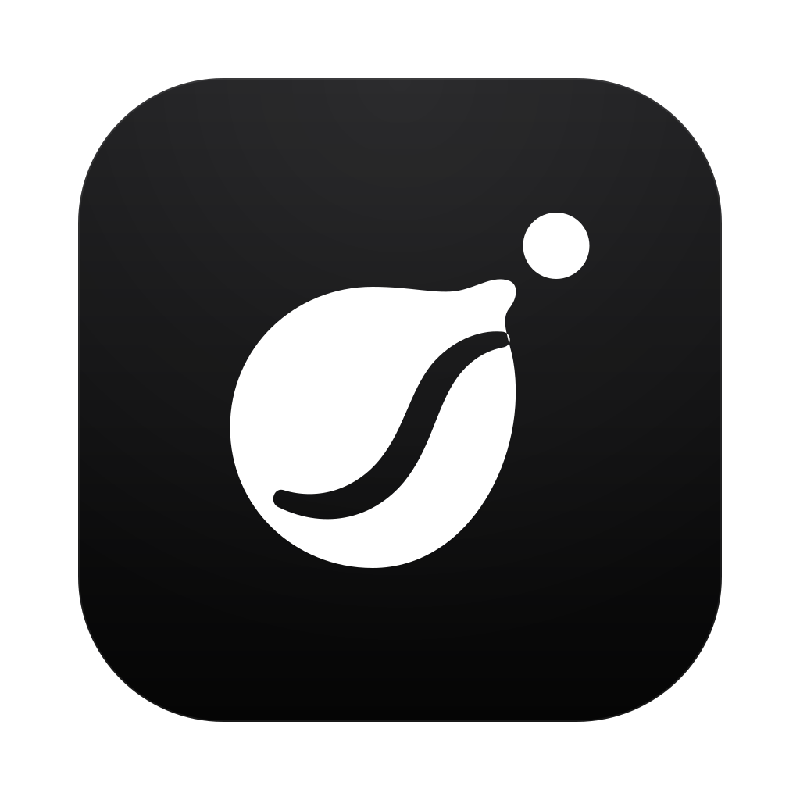
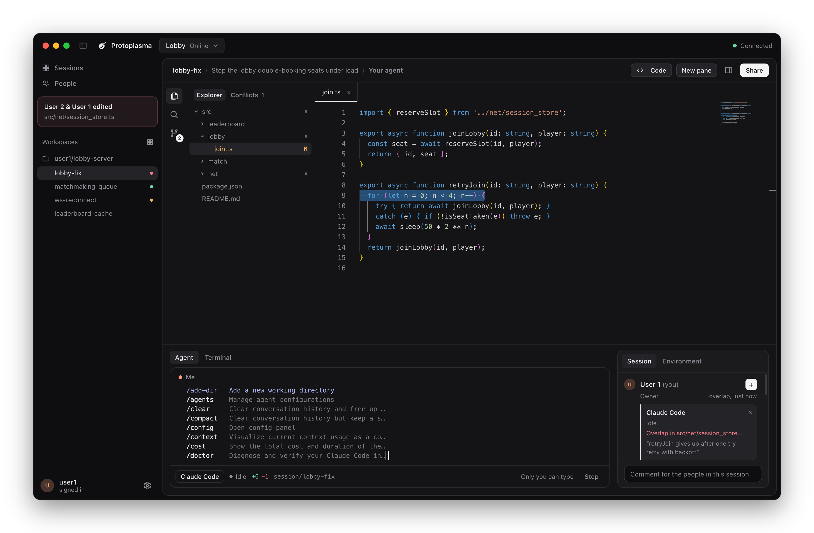
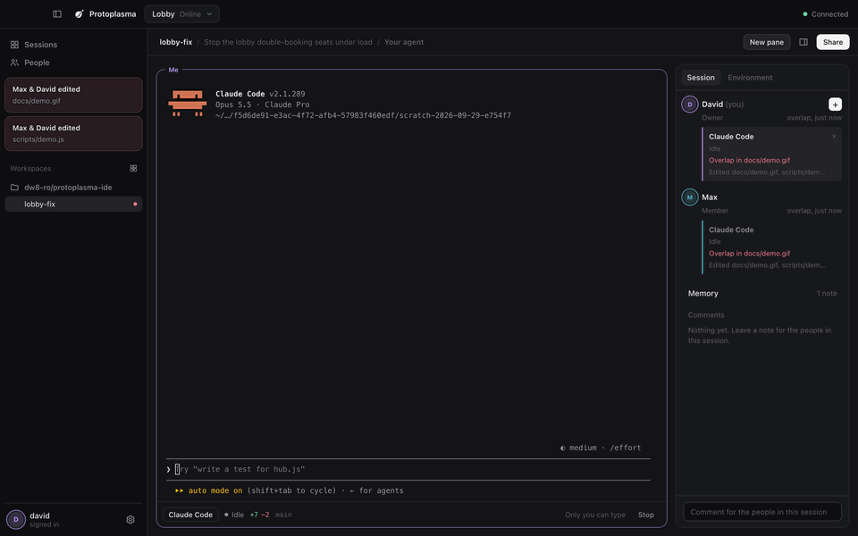
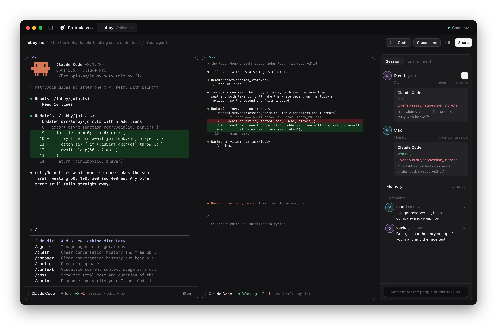
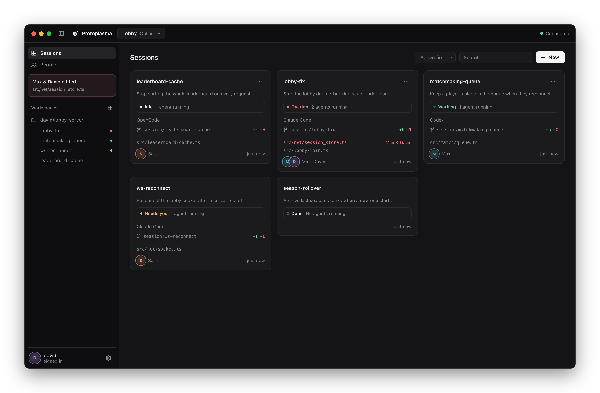
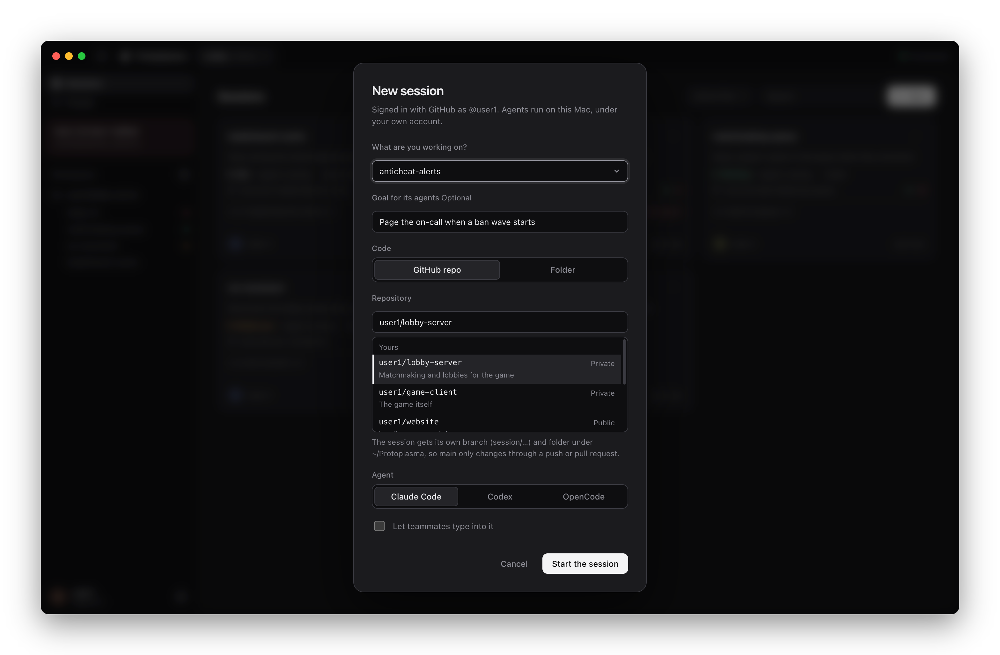
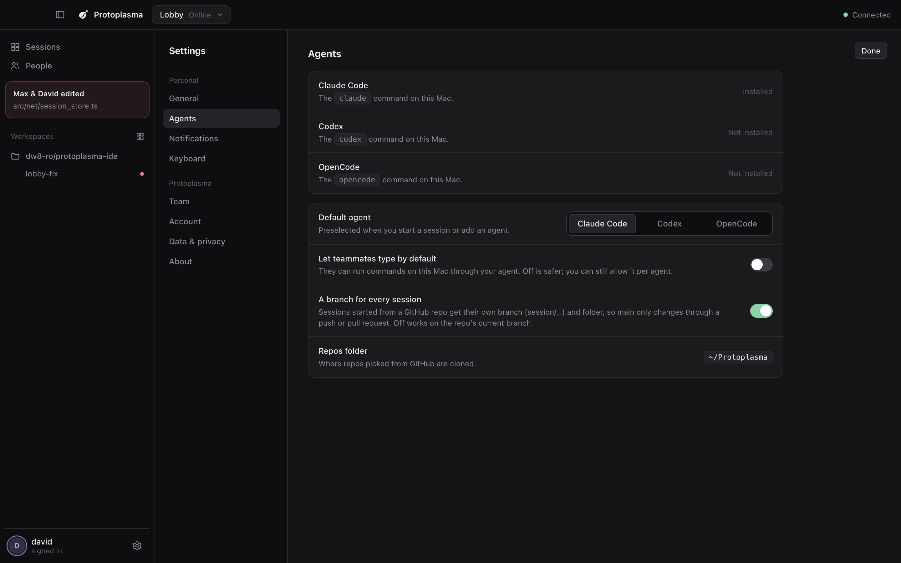
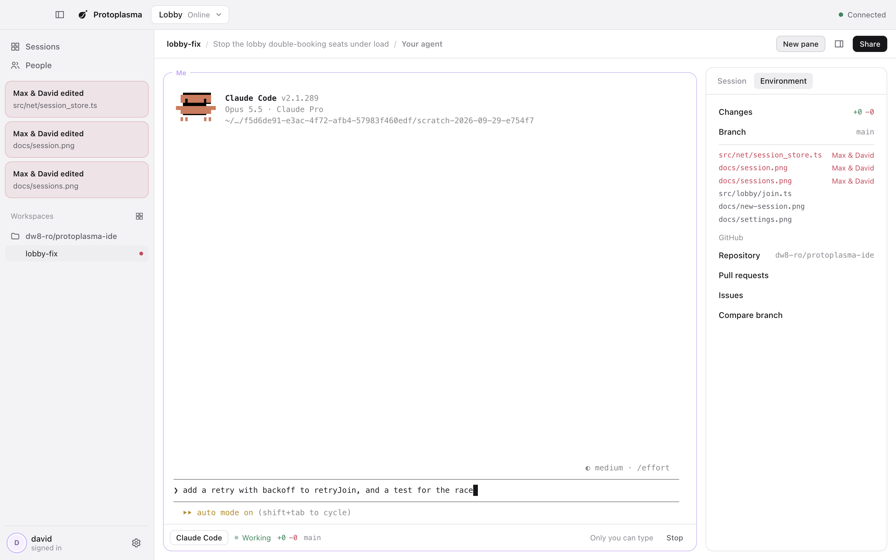
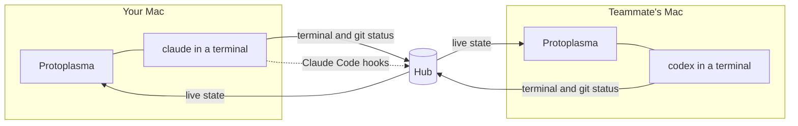

<p align="center">
  
</p>

<h1 align="center">Protoplasma</h1>

<p align="center">
  A multiplayer workspace for AI coding agents.<br>
  Run the real Claude Code, Codex or OpenCode on your Mac, every slash command included, and see your team's agents right beside yours.
</p>

<p align="center">
  <a href="https://github.com/dw8-ro/protoplasma-ide/actions/workflows/ci.yml"></a>
  
  
  
</p>

<p align="center">
  
</p>

## Why

Shared spaces for coding agents, like [Amoeba](https://useamoeba.com), drive the agents headlessly, so the CLI you know (its `/goal`, `/compact`, custom commands and skills) isn't there. Protoplasma runs the real interactive CLI in a real terminal and puts the team layer around it: who is working on what, which files are about to collide, and what each agent was last asked. It's laid out the way Amoeba is, so anyone coming from it already knows where things are.

## How you use it

1. **Sign in with GitHub** and create a team. Invite people by their GitHub username.
2. **Start a session** with **New** (⌘N). Say what you're working on, pick one of your GitHub repos (or a folder on your Mac) and an agent: Claude Code, Codex or OpenCode. Protoplasma clones the repo, gives the session its own branch and folder, and opens your agent.
3. **Talk to your agent.** It's the real CLI in a terminal, so you type to it exactly as you would in Terminal, slash commands included.
4. **Open the code.** Click **Code**, or any file the session has changed, or press ⌘P. The repo opens in an editor with its files, search and source control, and your agent moves to a panel underneath. As the agent edits a file you have open, you see the change straight away. A **Terminal** tab beside the agent gives you a plain shell in the same folder, and **Conflicts** lists files you and a teammate are both changing, with a side-by-side compare.
5. **Work alongside your team.** Everyone's agents in the session are listed on the right with what they were last asked. Open any of them full size or beside yours, or a teammate's version of a file their agent is changing (if they share files). Plan the work as steps, comment on lines of code (⇧⌘M), and keep notes the agents read. A file changed in two places is flagged for everyone, and Claude asks before touching it. **New pane** puts several sessions side by side.
6. **Ship it.** Write a message under source control and **Commit & Push**, then open a pull request.

<p align="center">
  
</p>

<details>
<summary>Keyboard shortcuts</summary>

| Keys | Does |
| --- | --- |
| ⌘N | New session |
| ⇧⌘L | Add an agent to this session |
| ⌘K | Go to a session, page or action |
| ⌘P | Go to a file |
| ⇧⌘E | Show or hide the code |
| ⌘S | Save the open file |
| ⇧⌘M | Comment on the selected lines |
| ⌘J | Hide the panel (under the code, or beside the agents) |
| ⌘B | Hide the sidebar |
| ⌘, | Settings |
</details>

## What it does

**The real agent, not a wrapper.** Each agent is the actual `claude`, `codex` or `opencode` process on your Mac, under your own account. Your settings, permission modes and custom commands all work.

**The code beside it.** An editor built on Monaco (the editor inside VS Code), with an Explorer that marks what changed since the last commit and which files teammates' agents are changing.

**Sessions for every piece of work.** Each one keeps its goal, branch and comments, and stays on the board after its agents stop, with **Resume** to pick the conversation back up and the last screen of recently stopped agents one click away.

**Collisions caught early.** Every checkout reports the files it has changed compared with main, committed or not, whoever or whatever changed them. A file changed in two places is an overlap for everyone, before it turns into a merge conflict.

**Plans and shared memory.** Each session can have a plan: steps with owners that anyone ticks off, shown on its card. Notes go with a repo or a single file. Claude gets all of it at the right moment: the plan and repo notes with every prompt, a file's notes just before it reads or edits it.

<p align="center">
  
</p>
<p align="center">
  
  
</p>
<p align="center">
  
  
</p>

## How it works



- **Lanes** (`src/lane.js`) run an agent in a pseudo-terminal and stream it to the hub, with its branch, what it has changed compared with main, and its status. Claude Code also gets per-run [HTTP hooks](https://code.claude.com/docs/en/hooks) through `--settings`; Codex and OpenCode report working or idle from their terminal activity.
- **The hub** (`src/hub.js`) relays terminals, tracks who changed what, keeps sessions, notes and comments, and answers Claude's hooks with the session's goal, the team's notes and an `ask` before a conflicting edit or a risky push. It never runs agents, and what it keeps or passes along is listed under Security and privacy.
- **The app** (`app/`) is Electron. The renderer has no Node access. The main process launches the agent CLIs (in a clean login-shell environment) and a shell for the Terminal tab, and the code view can only read and write inside a session's own folder.

## Working on the same code

1. **A branch per session.** A session started from a GitHub repo gets its own git worktree on `session/<name>`, branched from the latest default branch, or continuing a teammate's pushed branch. It has no upstream, so a bare `git push` can't land on `main`. Names that differ only in case or punctuation are the same session.
2. **Overlap warnings.** A file changed in two checkouts of the same repo is flagged for everyone, and Claude is asked before it edits one.
3. **Push guard.** Claude is asked before pushing to `main` or `master`, or force-pushing, when the team has other people. Codex and OpenCode can't be asked, so in repos the app cloned a `pre-push` hook stops them instead. People pushing from their own terminal aren't affected.
4. **Behind notice.** Each lane fetches about once a minute. A branch missing commits from main (or from its own pushed copy) shows `↓3`, and Claude is told to pull before changing more.
5. **Shared session branches.** Everyone in a session works on `session/<name>`, each in their own checkout. **Commit & Push** puts your commit on top of whatever a teammate pushed first, and stops to let you sort it out if you both changed the same lines.

Work then reaches `main` the usual way, through a pull request. These layers make collisions visible early; they don't replace review.

## Install

You'll need a Mac with Apple silicon and at least one of [Claude Code](https://code.claude.com), Codex or OpenCode. The [GitHub CLI](https://cli.github.com) is optional and powers the repo list, pull requests and issues. On first run the app checks for both and tells you what's missing.

```bash
gh api repos/dw8-ro/protoplasma-ide/contents/install.sh -H "Accept: application/vnd.github.raw" | sh
```

That installs the latest release into Applications, with no "can't be verified" warning (files fetched from Terminal aren't quarantined). You can also download the zip from [Releases](https://github.com/dw8-ro/protoplasma-ide/releases); the first time you open it, macOS asks you to allow it under System Settings → Privacy & Security → Open Anyway.

**Updates install themselves.** The app checks GitHub every few hours and shows a bar when a new version is out: Update now, and it relaunches on the new one. Releases are signed with the project's own certificate (no Apple account involved), so macOS knows each version is the same app and your Keychain and privacy permissions carry over.

### From source

```bash
git clone https://github.com/dw8-ro/protoplasma-ide.git
cd protoplasma-ide
npm install
npm start
```

`npm run dist` builds the app into `dist/Protoplasma-darwin-arm64/`, and `npm run release` publishes a new version: it bumps the version and pushes a tag, and GitHub Actions builds the app and attaches it to a release that everyone's copy picks up.

<details>
<summary>Configuration and hosting a hub</summary>

`app/config.json` holds two values:

- `githubClientId`: from a GitHub OAuth app with device flow enabled. It's public, not a secret.
- `onlineHub`: the URL of your hosted hub. Leave it empty to use teams on your own Mac only.

To host a hub, deploy the `Dockerfile` (Railway or any container host) with a volume at `/data` and set `DATA_DIR=/data` and `PROTO_OWNERS` to the GitHub logins allowed to create teams.
</details>

<details>
<summary>Wire protocol</summary>

The first message on every WebSocket carries a GitHub token and a team id; nothing else is accepted until both are verified.

| Endpoint | Direction | Messages |
| --- | --- | --- |
| `/lane` | lane → hub | `hello`, `out {d}`, `size {cols, rows}`, `git {branch, added, removed, files, behind, ahead, changed}`, `status {status}` |
| | hub → lane | `in {d}` (only for agents teammates may type into) |
| `/watch` | app → hub | `watch {token, team}`, `look {session}`, `in {lane, d}`, `replay {id}` |
| | hub → app | `state {lanes, watchers, memories, sessions, stopped}`, `out {lane, d}`, `replay {id, d}` |
| `/teams` | app → hub | REST for teams, members, notes, sessions and comments |
| `/hooks/:lane` | Claude Code → hub | Hook events, authenticated with a per-lane secret |
</details>

## Development

```bash
npm test            # hub, lane and worktree tests (node:test)
npm run e2e         # drives the real app through every main flow, the code view included
npm run screenshot  # regenerates the images in docs/
npm run demo        # records docs/demo.gif
npm run playground  # two copies of the app, David and Max, on one shared team and repo, each with a control API
npm run icon        # renders the app icon from app/icon.svg
```

```
app/      Electron main process, preload bridge and interface
src/      hub, lane and session worktrees (plain Node, shared by the app and the hosted hub)
test/     integration tests against real hubs, lanes and git repos
scripts/  end-to-end check, screenshots, demo and icon tooling
```

## Security and privacy

- Sign-in asks for read-only access to your public GitHub profile, and nothing else. Repo access stays with the GitHub CLI on your Mac.
- The hub keeps team names, members, notes, and sessions with their goals, plans and comments (a comment on lines of code keeps the text of those lines). Terminal output and Claude Code's hook events, which include what a tool is about to change, pass through it and are held in memory only.
- Looking for teams hosted on a teammate's Mac is off until you turn it on in Your teams: it shows your GitHub sign-in to every Mac on the network that answers.
- The code view reads and writes files on your Mac only. The hub never stores your code: teammates see which files changed, not what's in them, unless you turn on **Share the files your agents change** (Settings → Agents, off by default). Then a teammate can open those files, read-only; each one passes through the hub on the way and isn't kept.
- Teams are invite-only, and removing someone disconnects them at once.
- Letting teammates type into your agent lets them run commands on your Mac, so it's off unless you turn it on, and your agent shows who last typed into it.
- Teams hosted on your own Mac use plain HTTP; on a shared network, use an online team.

## Roadmap

- [ ] Notarised builds, so browser downloads open without the first-launch prompt
- [ ] Coordination tools over MCP, so agents can leave notes and message each other
- [ ] Viewer role

## Licence

[MIT](LICENSE). The team features are inspired by [Amoeba](https://useamoeba.com) and built independently from its public documentation.
