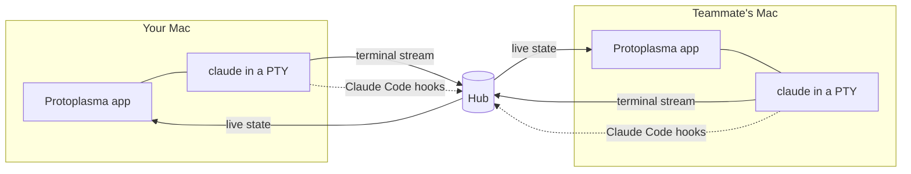

<p align="center">
  
</p>

<h1 align="center">Protoplasma</h1>

<p align="center">
  A multiplayer workspace for AI coding agents. Run Claude Code, Codex or OpenCode on your own machine and see your team's agents next to it.
</p>

<p align="center">
  <a href="https://github.com/dw8-ro/protoplasma-ide/actions/workflows/ci.yml"></a>
  
  
  
</p>


## Why

Tools like [Amoeba](https://useamoeba.com) let a team share one space for their coding agents, but they drive the agents headlessly, so the CLI's slash commands (`/goal`, `/compact`, custom commands, skills) aren't available. Protoplasma runs the real interactive CLI in a real terminal, then adds the team layer on top. It's laid out the way Amoeba is (Sessions, People and Workspaces in the sidebar, a session panel beside your agent), so anyone coming from it already knows where things are.

## Features

- **Real terminals.** Each agent is the actual `claude`, `codex` or `opencode` CLI in a pseudo-terminal, so every slash command works.
- **Teams through GitHub.** Sign in with GitHub, create a team and invite people by username from the People page. No IP addresses or tokens to pass around.
- **Online or local.** Teams live on a hosted hub, or on a hub inside your app that teammates on the same network discover over Bonjour.
- **Sessions.** Start one by picking a repo and saying what you're working on. Agents are told the goal, and the session stays on the Sessions page after they stop until someone marks it done. The sidebar groups open sessions under their workspace (repo).
- **One agent at a time, or two side by side.** A session opens on your own agent at full size. The session panel lists everyone's agents with their latest prompt; click one to watch it, add another of your own with `+`, or open a second pane.
- **Comments.** Each session has a comment thread for the people in it ("I'll take the auth part"), next to Memory, which is for the agents.
- **Pick a repo.** Search a list of your GitHub repos and the ones shared with you; the app clones it for you.
- **Guard rails for working together** (see [Working on the same code](#working-on-the-same-code)): a branch per session, overlap warnings, a check before pushing to `main`, and a heads-up when your branch falls behind.
- **Shared memory.** Notes for the whole repo or a single file. Claude gets them automatically at the right moment.
- **Environment.** Each session shows its branch, live uncommitted changes (+/−), edited files, and its repo's pull requests and issues (via the GitHub CLI).
- **Alerts and notifications.** The sidebar only lists things you need to act on; a macOS notification and Dock badge tell you when an agent is waiting.
- **Settings.** Theme, terminal font, size and line height, which agents are installed, agent defaults, notifications, your team and account, and what data goes where (`⌘,`). The sidebar (`⌘B`) and session panel (`⌘J`) can be tucked away.

<p align="center">
  
  
</p>
<p align="center">
  
  
</p>

## How it works



- **Lanes** (`src/lane.js`) run an agent under your own account and stream its terminal to the hub. For Claude, they add per-run [HTTP hooks](https://code.claude.com/docs/en/hooks) through `--settings`.
- **The hub** (`src/hub.js`) relays terminals, tracks who edited what, keeps session records, and answers hooks. `UserPromptSubmit` adds the session goal, team context and repo notes, and `PreToolUse` adds file notes and asks before a conflicting edit or a risky push. It never runs agents and has no access to your repos. Terminal output and hook events pass through it but aren't stored beyond each agent's scrollback.
- **The app** (`app/`) is Electron. The renderer has no Node access, the main process only launches `claude`, `codex` or `opencode`, and agents get a clean login-shell environment.

## Working on the same code

Several people and agents in one repo is where things go wrong, so there are four layers:

1. **A branch per session.** Starting an agent from a GitHub repo puts the session in its own git worktree on `session/<name>`, branched from the latest default branch. If a teammate already pushed that branch, yours continues from theirs. The branch has no upstream, so a bare `git push` can't land on `main` (`src/workspace.js`). Names that differ only in case or punctuation ("Fix Login", "fix-login") are the same session, since they'd get the same branch.
2. **Overlap warnings.** Each lane reports the files its checkout has changed, alongside the edits Claude reports through its hooks, so changes made by shell commands, Codex, OpenCode or by hand count too. A file changed in two checkouts of the same repo shows as an overlap for everyone, and before Claude edits such a file the hub answers the `PreToolUse` hook with `ask`, so Claude stops for your decision.
3. **Push guard.** `git push` to `main` or `master`, and any force-push, also gets `ask` when the team has more than one person. Codex and OpenCode have no hooks to ask with, so in repos the app cloned a git `pre-push` hook stops them instead (people pushing from their own terminal aren't affected). Pushing a session branch is never interrupted.
4. **Behind notice.** Each lane fetches about once a minute and reports how far its branch is behind. The UI shows it (`↓3`), and Claude is told to pull or rebase before changing more or pushing.

Claude also gets the session's goal and the team's notes through its hooks. Codex and OpenCode don't, and nothing can stop them in the middle of an edit, but their changes still show up as overlaps for everyone.

Work then reaches `main` the usual way: push the session branch and open a pull request, which shows up in the session's Pull requests tab. Git itself still has the last word. These layers make collisions visible early; they don't replace review.

<details>
<summary>Wire protocol</summary>

The first message on every WebSocket carries a GitHub token and a team id. Nothing else is accepted until both are verified.

| Endpoint | Direction | Messages |
| --- | --- | --- |
| `/lane` | lane → hub | `hello {token, team, id, hookSecret, session, cmd, root, repo, branch, git, cols, rows, open, history}`, `out {d}`, `size {cols, rows}`, `git {branch, added, removed, files, behind, ahead}` |
| | hub → lane | `in {d}` (only for lanes started as open) |
| `/watch` | app → hub | `watch {token, team}`, `look {session}`, `in {lane, d}` |
| | hub → app | `state {lanes, watchers, memories, sessions}`, `out {lane, d}` |
| `/teams` | app → hub | REST: list and create teams, manage members, memories and sessions |
| `/hooks/:lane` | Claude Code → hub | Hook events, authenticated with a per-lane secret |

Close codes `4001` (not signed in) and `4003` (not on the team) stop a lane from retrying.
</details>

## Getting started

Requirements: macOS on Apple silicon, Node 20+, and at least one of the [Claude Code](https://code.claude.com), Codex or [OpenCode](https://opencode.ai) CLIs. The [GitHub CLI](https://cli.github.com) is optional and enables repos, PRs and issues.

```bash
git clone https://github.com/dw8-ro/protoplasma-ide.git
cd protoplasma-ide
npm install
npm start
```

To build the app bundle, run `npm run dist`. The result is in `dist/Protoplasma-darwin-arm64/`.

### Configuration

`app/config.json` holds two values:

- `githubClientId`: from a GitHub OAuth app with device flow enabled. It's public, not a secret.
- `onlineHub`: the URL of your hosted hub. Leave it empty to use local teams only.

To host a hub, deploy the `Dockerfile` (Railway or any container host) with a volume at `/data` and these variables: `DATA_DIR=/data` and `PROTO_OWNERS=<your GitHub login>`.

## Development

```bash
npm test            # hub and lane integration tests (node:test)
npm run e2e         # drives the real app through its main flows and prints PASS/FAIL per step
npm run hub         # standalone hub
npm run screenshot  # regenerate the images in docs/
npm run icon        # re-render the app icon from app/icon.svg
```

```
app/       Electron main process, preload bridge and UI
src/       hub, lane and session worktrees (plain Node, shared by the app and the hosted hub)
test/      integration tests
scripts/   screenshot and icon tooling
```

## Security

- The sign-in token has the `read:user` scope only. Repo access stays with `gh` on your machine.
- Teams are invite-only. Removing a member disconnects them immediately, members can leave, and the owner can delete the team.
- Letting teammates type into your agent means letting them run commands on your machine, so it's off by default.
- Local ("This Mac") hubs use plain HTTP. On shared networks, use an online team.

## Roadmap

- [ ] Plans with owners and step status
- [ ] Coordination tools over MCP, so agents can write notes and message each other
- [ ] Viewer role
- [ ] Signed and notarized builds

## Acknowledgements

The team features are inspired by [Amoeba](https://useamoeba.com) and built independently from its public documentation.
