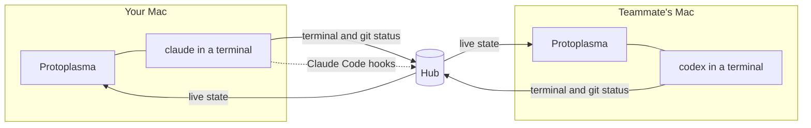

<p align="center">
  
</p>

<h1 align="center">Protoplasma</h1>

<p align="center">
  A multiplayer workspace for AI coding agents.<br>
  Run the real Claude Code, Codex or OpenCode on your Mac, every slash command included, and see your team's agents right beside yours.
</p>

<p align="center">
  <a href="https://github.com/dw8-ro/protoplasma-ide/actions/workflows/ci.yml"></a>
  
  
  
</p>

<p align="center">
  
</p>

## Why

Shared spaces for coding agents, like [Amoeba](https://useamoeba.com), drive the agents headlessly, so the CLI you know (its `/goal`, `/compact`, custom commands and skills) isn't there. Protoplasma runs the real interactive CLI in a real terminal and puts the team layer around it: who is working on what, which files are about to collide, and what each agent was last asked. It's laid out the way Amoeba is, so anyone coming from it already knows where things are.

## What it does

**The real agent, not a wrapper.** Each agent is the actual `claude`, `codex` or `opencode` process in a terminal on your Mac, running under your own account. Slash commands, permission modes and your settings all work as usual.

**Sessions for every piece of work.** Pick a repo, say what you're working on, and the session gets its own branch and folder. It stays on the board after its agents stop, with **Resume** to pick the conversation back up and the last screen of every stopped agent one click away.

**See the whole team.** The session panel lists everyone's agents with their status and latest prompt. Watch any of them full size, put one beside yours, and leave comments for the people in the session.

**Collisions caught early.** Every checkout reports the files it has changed, whether Claude, a shell command, Codex or a person changed them. A file changed in two places shows as an overlap for everyone, and Claude stops to ask before touching it.

**Shared memory.** Notes for a repo or a single file. Claude gets them at the right moment: repo notes with every prompt, a file's notes just before it reads or edits it.

**Built around GitHub.** Sign in with GitHub, invite people by username, pick from your repos and the ones shared with you, and see each session's pull requests and issues.

**Quick to drive.** `⌘K` jumps to any session, page or action. `⌘B` and `⌘J` tuck away the sidebar and session panel. Dark, light or system theme, with your choice of terminal font.

<p align="center">
  
  
</p>
<p align="center">
  
  
</p>

## How it works



- **Lanes** (`src/lane.js`) run an agent in a pseudo-terminal and stream it to the hub, with its branch, uncommitted changes and status. Claude Code also gets per-run [HTTP hooks](https://code.claude.com/docs/en/hooks) through `--settings`; Codex and OpenCode report working or idle from their terminal activity.
- **The hub** (`src/hub.js`) relays terminals, tracks who changed what, keeps sessions, notes and comments, and answers Claude's hooks with the session's goal, the team's notes and an `ask` before a conflicting edit or a risky push. It never runs agents and never sees your code.
- **The app** (`app/`) is Electron. The renderer has no Node access, the main process only launches the three agent CLIs, and agents get a clean login-shell environment.

## Working on the same code

1. **A branch per session.** A session started from a GitHub repo gets its own git worktree on `session/<name>`, branched from the latest default branch, or continuing a teammate's pushed branch. It has no upstream, so a bare `git push` can't land on `main`. Names that differ only in case or punctuation are the same session.
2. **Overlap warnings.** A file changed in two checkouts of the same repo is flagged for everyone, and Claude is asked before it edits one.
3. **Push guard.** Claude is asked before pushing to `main` or `master`, or force-pushing, when the team has other people. Codex and OpenCode can't be asked, so in repos the app cloned a `pre-push` hook stops them instead. People pushing from their own terminal aren't affected.
4. **Behind notice.** Each lane fetches about once a minute. A branch that has fallen behind shows `↓3`, and Claude is told to pull before changing more.

Work then reaches `main` the usual way, through a pull request. These layers make collisions visible early; they don't replace review.

## Getting started

You'll need macOS on Apple silicon, Node 20 or later, and at least one of [Claude Code](https://code.claude.com), Codex or OpenCode. The [GitHub CLI](https://cli.github.com) is optional and powers the repo list, pull requests and issues. On first run the app checks for the agents and the GitHub CLI and tells you what's missing.

```bash
git clone https://github.com/dw8-ro/protoplasma-ide.git
cd protoplasma-ide
npm install
npm start
```

`npm run dist` builds the app into `dist/Protoplasma-darwin-arm64/`.

<details>
<summary>Configuration and hosting a hub</summary>

`app/config.json` holds two values:

- `githubClientId`: from a GitHub OAuth app with device flow enabled. It's public, not a secret.
- `onlineHub`: the URL of your hosted hub. Leave it empty to use teams on your own Mac only.

To host a hub, deploy the `Dockerfile` (Railway or any container host) with a volume at `/data` and set `DATA_DIR=/data` and `PROTO_OWNERS` to the GitHub logins allowed to create teams.
</details>

<details>
<summary>Wire protocol</summary>

The first message on every WebSocket carries a GitHub token and a team id; nothing else is accepted until both are verified.

| Endpoint | Direction | Messages |
| --- | --- | --- |
| `/lane` | lane → hub | `hello`, `out {d}`, `size {cols, rows}`, `git {branch, added, removed, files, behind, ahead, changed}`, `status {status}` |
| | hub → lane | `in {d}` (only for agents teammates may type into) |
| `/watch` | app → hub | `watch {token, team}`, `look {session}`, `in {lane, d}`, `replay {id}` |
| | hub → app | `state {lanes, watchers, memories, sessions, stopped}`, `out {lane, d}`, `replay {id, d}` |
| `/teams` | app → hub | REST for teams, members, notes, sessions and comments |
| `/hooks/:lane` | Claude Code → hub | Hook events, authenticated with a per-lane secret |
</details>

## Development

```bash
npm test            # hub, lane and worktree tests (node:test)
npm run e2e         # drives the real app through every main flow
npm run screenshot  # regenerates the images in docs/
npm run demo        # records docs/demo.gif
npm run icon        # renders the app icon from app/icon.svg
```

```
app/      Electron main process, preload bridge and interface
src/      hub, lane and session worktrees (plain Node, shared by the app and the hosted hub)
test/     integration tests against real hubs, lanes and git repos
scripts/  end-to-end check, screenshots, demo and icon tooling
```

## Security and privacy

- Sign-in asks for read-only access to your public GitHub profile, and nothing else. Repo access stays with the GitHub CLI on your Mac.
- The hub keeps team names, members, notes, and sessions with their goals and comments. Terminal output passes through it and is held in memory only.
- Teams are invite-only, and removing someone disconnects them at once.
- Letting teammates type into your agent lets them run commands on your Mac, so it's off unless you turn it on.
- Teams hosted on your own Mac use plain HTTP; on a shared network, use an online team.

## Roadmap

- [ ] Signed and notarised builds with automatic updates
- [ ] Plans with owners and step status
- [ ] Coordination tools over MCP, so agents can leave notes and message each other
- [ ] Viewer role

## Licence

[MIT](LICENSE). The team features are inspired by [Amoeba](https://useamoeba.com) and built independently from its public documentation.
